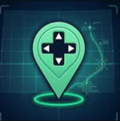
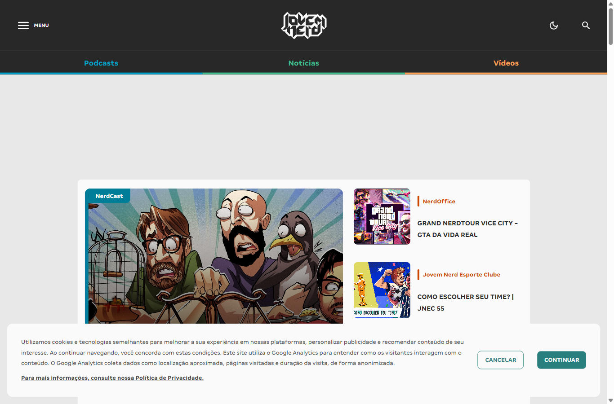
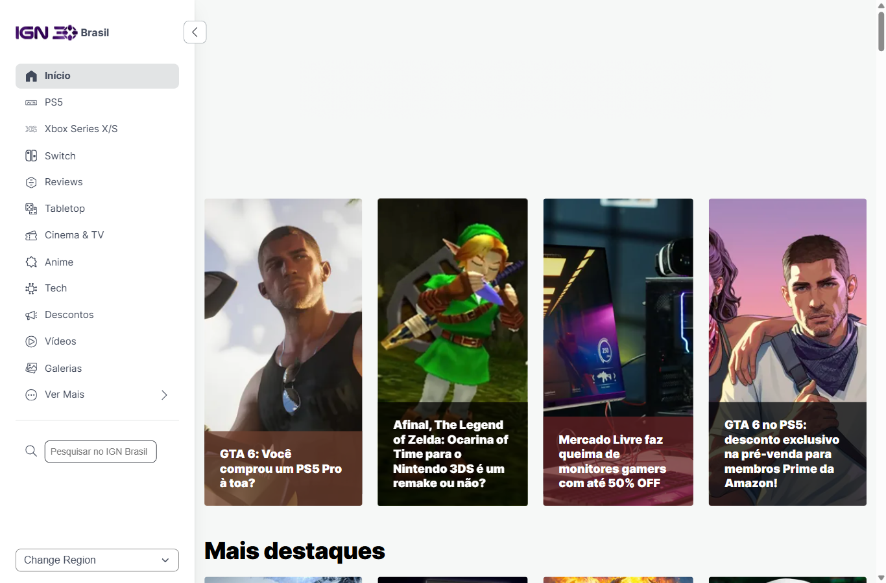

# Diagnóstico de Referências: Checkpoint Pop

> Data: 2026-11-03 · Etapa 1 do `/onboarding`

## Briefing

| Item | Definição |
| :--- | :--- |
| **Marca** | Checkpoint Pop ([@checkpoint_pop](https://www.instagram.com/checkpoint_pop/)) |
| **Formato** | Perfil de **cortes**: vídeos curtos (Reels/Shorts/TikTok) |
| **Conteúdo** | Games (foco principal), filmes e séries da cultura pop |
| **Estágio** | Perfil novo: 0 posts, 0 seguidores, sem bio. Só a foto de perfil existe como ativo visual |

---

## 1. Leitura da marca atual

### Ativo existente: avatar

Um **pin de localização verde-menta com um D-pad** (direcional de controle) no centro, sobre um fundo **azul-noite com grade de radar/HUD**, um anel de luz verde na base e uma linha fina de rota/circuito.

**Conceito:** "Checkpoint" tem dois sentidos, o **ponto de salvamento** dos games e a **marcação no mapa**. Na prática, o perfil se posiciona como *o lugar onde você para e encontra os melhores momentos*. O nome e o símbolo conversam muito bem.

### Paleta detectada (pixels do avatar)

| Papel | Cor | HEX | Presença |
| :--- | :--- | :--- | :--- |
| Fundo profundo | Azul-noite | `#071B34` · `#05162A` | ~30% |
| Fundo médio | Petróleo escuro | `#13364A` · `#09253B` | ~30% |
| Grade / HUD | Teal médio | `#195964` · `#19656A` | ~8% |
| Destaque | Verde-menta neon | `#56C996` → `#7AE6B4` | ~5% |
| Ícone | Branco / preto | `#FFFFFF` · `#000000` | detalhe |

### Pontos fortes
- **Conceito do nome + símbolo** com duplo sentido inteligente e memorável.
- **Verde-menta** é um acento pouco usado no nicho BR, que tende ao vermelho, laranja e roxo, e tem ótimo contraste sobre o azul-noite.
- O pin funciona como **marca d'água** de canto nos cortes, por ser simples e reconhecível.

### Pontos de atenção
- **Fundo escuro + grade HUD/radar** é um dos clichês mais repetidos do visual gamer: diferencia pouco.
- O avatar tem **detalhes finos** (grade, linha de rota) que somem em tamanho pequeno (avatar de 110px e marca d'água).
- **Não há tipografia** definida, e para um perfil de cortes a **legenda e o título na tela são a marca**.
- Falta um **acento quente** para os ganchos de urgência ("OLHA ISSO", "VAZOU"), essencial em cortes.

---

## 2. Padrões das referências do nicho

Como o usuário ainda não tem referências próprias, foram analisadas duas grandes marcas BR de games e cultura pop, além dos padrões recorrentes de perfis de cortes.
*(O The Enemy também foi tentado, mas o site retornou erro de certificado.)*

### Jovem Nerd: [jovemnerd.com.br](https://jovemnerd.com.br/)

- **Fundos:** cinza-claro `#E8E8E8` / `#FAFAFA` no conteúdo, grafite `#282828` no header.
- **Acentos por editoria:** laranja-queimado `#CC4700`, teal `#007D99` / `#297E7E` e verde, um código de cor por tipo de conteúdo.
- **Tipografia:** sans humanista proprietária (pesos 400–900), títulos em CAIXA ALTA.
- **Imagem:** **ilustração/cartoon** autoral dos apresentadores, muito expressiva, que é a assinatura da marca.

### IGN Brasil: [br.ign.com](https://br.ign.com/)

- **Fundos:** brancos/off-white `#F6F8F7`, com cards de imagem que levam um degradê escuro na base.
- **Acento:** vermelho IGN `#BF1313`.
- **Tipografia:** **Inter** (400/700/900): títulos pesados, compactos, em caixa baixa.
- **Imagem:** **key art / screenshots oficiais** em tela cheia + título sobreposto. O conteúdo é o herói, a marca fica discreta.

### Padrões gerais de perfis de cortes (Reels/Shorts/TikTok)
- **Legenda gigante em caixa alta** (Impact, Anton, Montserrat Black), branca com contorno preto, palavra-chave em **amarelo**.
- **Layout "sanduíche":** título fixo no topo, vídeo no meio, legenda embaixo, com faixas pretas.
- **Rosto em close + emoji + seta vermelha** nas capas.
- **Marca d'água** de canto com @ do perfil.
- **Cores de urgência:** vermelho, amarelo e preto dominam.

### O que o nicho repete (clichês)
1. Vermelho/preto/amarelo como paleta de "urgência".
2. HUD, glitch, RGB e neon roxo/ciano como "estética gamer".
3. Capas poluídas: muitos elementos, três cores de texto, emojis empilhados.
4. Grade inconsistente: cada corte tem uma capa diferente, e o feed vira um mosaico sem identidade.

---

## 3. Oportunidades de diferenciação

### Território 1: "Save Point": o feed como mapa
Assumir o pin como sistema: cada corte é um **checkpoint marcado no mapa**. Capas com o mesmo template fixo (moldura menta, pin, título), selos de categoria (🎮 GAME · 🎬 FILME · 📺 SÉRIE) como "ícones de mapa". O feed vira um **mosaico organizado e reconhecível**, coisa rara em perfis de cortes.

### Território 2: "Menta contra o vermelho"
Enquanto o nicho grita em vermelho e amarelo, o Checkpoint Pop marca território com **verde-menta + azul-noite**, usando **um único acento quente** só nos ganchos. É reconhecível no scroll justamente por ser diferente.

### Território 3: "Pop arcade autoral"
Puxar o **"Pop"** do nome: elementos de **pop art / arcade retrô** (halftone, pixel, sticker com contorno branco, colagem de personagem recortado) aplicados sobre os frames dos cortes. Mais divertido e menos "tech frio" que o avatar atual.

> **Recomendação inicial:** combinar o **Território 1** (sistema e consistência) com o **2** (cor proprietária) e usar pitadas do **3** no tom.

---

## Arquivos de referência

| # | Arquivo | Origem |
| :--- | :--- | :--- |
| 00 | [00-checkpoint-pop-avatar.png](../assets/referencias/00-checkpoint-pop-avatar.png) | Avatar do @checkpoint_pop |
| 01 | [01-checkpoint-pop-instagram.png](../assets/referencias/01-checkpoint-pop-instagram.png) | Perfil no Instagram (com login wall) |
| 02 | [02-jovem-nerd.png](../assets/referencias/02-jovem-nerd.png) | jovemnerd.com.br |
| 03 | [03-ign-brasil.png](../assets/referencias/03-ign-brasil.png) | br.ign.com |
